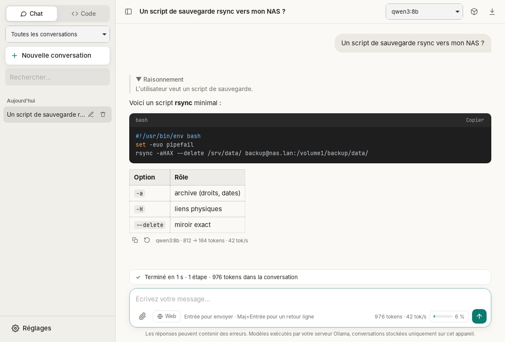
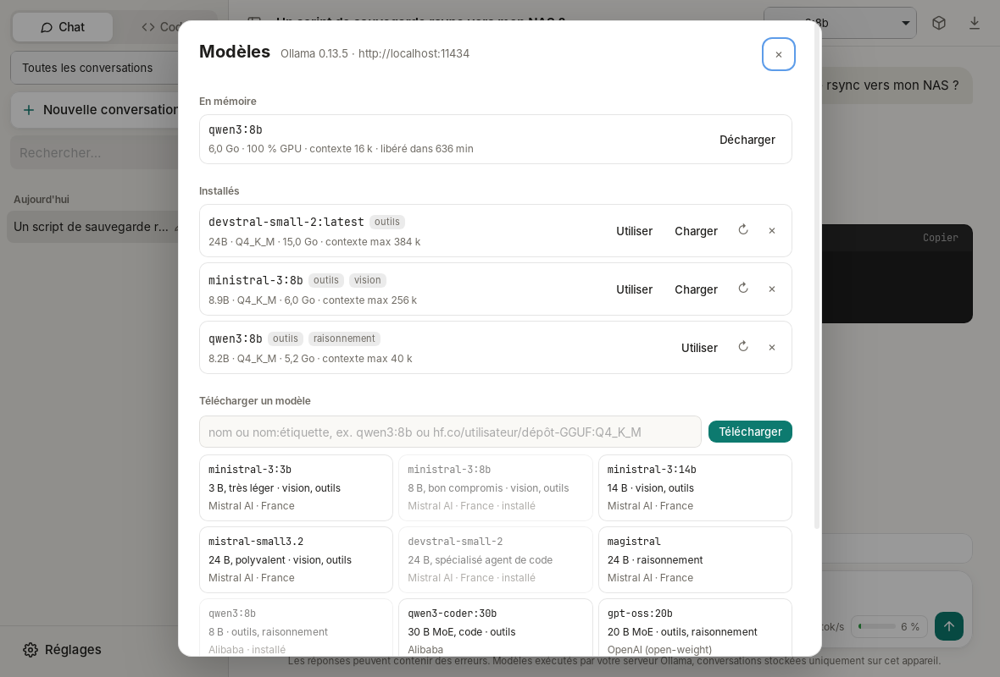

# Ollama Desktop

Client de bureau **léger, open source et sans télémétrie** pour [Ollama](https://ollama.com), dans l'esprit de Claude Desktop : chat, **agent de code**, **projets**, **recherche web** (SearXNG), **PDF** et **serveurs MCP**, avec un **gestionnaire de modèles** intégré. macOS, Windows et Linux.

Tout s'exécute sur **votre** serveur Ollama (ce PC, une machine du LAN, un serveur GPU) : aucune donnée ne part chez un fournisseur d'IA.

> Projet indépendant, non affilié à Ollama. Dérivé de [Mistral Desktop](https://github.com/r0mish/Mistral-Desktop).



## Fonctionnalités

### Serveur Ollama
- **Local** (`http://localhost:11434`, par défaut), **réseau privé** (`http://192.168.1.20:11434`, `http://gpu.lan:11434`, Tailscale…) ou **distant en HTTPS**. HTTP en clair refusé vers Internet
- Écran d'accueil si Ollama est injoignable (installation, `ollama serve`), reconnexion automatique dès qu'il démarre
- **Clé API facultative** (Ollama derrière un reverse proxy authentifiant : Caddy, Nginx, Traefik…), envoyée en `Authorization: Bearer`, stockée dans le trousseau du système
- API **native** d'Ollama (`/api/chat`) : `num_ctx`, `keep_alive`, raisonnement (`think`), images, appels d'outils

### Gestionnaire de modèles (`Ctrl/⌘+M`)



- **Modèles en mémoire** (`/api/ps`) : taille, répartition CPU/GPU, contexte, expiration ; bouton **Décharger** pour libérer la VRAM
- **Modèles installés** : paramètres, quantification, taille, contexte max, capacités détectées (**outils**, **vision**, **raisonnement**) ; charger à l'avance, mettre à jour, supprimer
- **Téléchargement** avec progression et annulation (reprise là où il s'est arrêté), depuis la bibliothèque Ollama ou Hugging Face (`hf.co/utilisateur/dépôt-GGUF:Q4_K_M`)
- Suggestions de départ, **modèles européens en premier** (Mistral AI : `ministral-3`, `mistral-small3.2`, `devstral-small-2`, `magistral`), puis `qwen3`, `qwen3-coder`, `gpt-oss`, `gemma3`
- Le modèle choisi est conservé pour les nouvelles conversations ; à défaut, un modèle **déjà chargé** est préféré (pas d'attente de chargement)

### Chat
- Réponses en **streaming**, arrêt à tout moment (bouton ■ ou `Échap`), **vitesse de génération** (tok/s) affichée
- **Raisonnement** (qwen3, magistral, deepseek-r1, gpt-oss…) dans un bloc repliable, désactivable
- Rendu **Markdown** : tableaux, listes, blocs de code colorés avec bouton « Copier »
- Pièces jointes : **images** (modèles vision), **PDF** et **fichiers texte/code**, par bouton, glisser-déposer ou collage. Les images ne sont pas proposées à un modèle sans vision
- Historique local : **recherche plein texte**, renommage, suppression, regroupement par date ; modifier un message, régénérer une réponse, **export Markdown**
- **Fenêtre de contexte** réglable (`num_ctx`, 16 k par défaut, plafonnée au maximum du modèle), **jauge de contexte** et **compaction automatique** à 80 % (l'historique est résumé par le modèle)

### Projets
Comme dans Claude Desktop : des conversations regroupées qui partagent des **consignes** et des **fichiers de référence** (texte, Markdown, code, CSV, PDF).
- **Dossier de travail** du projet (local ou serveur SSH) pour les sessions de code
- **Gros projets** (au-delà de 60 000 caractères) : recherche locale BM25 par extraits, outil `search_project_files` pour le modèle. Aucun index ni embedding ne quitte la machine

### Agent de code (onglet **Code**)
Un agent façon Claude Code, avec un modèle local gérant les outils (`devstral-small-2`, `qwen3-coder`, `qwen3`, `gpt-oss`…) :
- Outils : `list_files`, `read_file`, `search_files` (regex, respecte `.gitignore`), `edit_file`, `write_file`, `run_command`, `git_status`, `git_diff`, `git_log`
- **Diff coloré** avant chaque modification, approbation commande par commande ; trois niveaux : **Tout demander**, **Modifs auto**, **Autonome**
- Accès **confiné au dossier choisi** ; **accès système** optionnel (fichiers hors projet, ex. `/etc/fail2ban/jail.local`) avec approbation systématique
- **Fichiers de consignes** lus automatiquement : `AGENTS.md`, `OLLAMA.md` ou `CLAUDE.md` ; génération d'`AGENTS.md` par l'agent
- **Serveurs SSH** : l'agent travaille directement sur un serveur via le client OpenSSH du système (alias, `ProxyJump`, clés de `~/.ssh/config`, ControlMaster), vérification des empreintes d'hôte
- **Git** (`Ctrl/⌘+G`) : branches, indexation, diff, commit avec **message généré** par le modèle, fetch/pull/push
- Le modèle choisi doit gérer les appels d'outils : l'application le vérifie avant de lancer l'agent

### Recherche web
Bascule **Web** dans la zone de saisie : `web_search` via votre instance **[SearXNG](https://docs.searxng.org)** (métamoteur libre, auto-hébergeable) et `fetch_url`. Les adresses du réseau local sont **bloquées** pour `fetch_url` (protection contre le sondage du LAN par une page piégée).

### PDF
Extraction du texte **en local** (rien n'est envoyé). Un PDF scanné est signalé : joignez des captures des pages à un modèle vision.

### Dictée vocale
Bouton micro (`Ctrl/⌘+Maj+D`), affiché une fois un **serveur de transcription auto-hébergé** configuré (Ollama ne transcrit pas l'audio) : toute API compatible `/v1/audio/transcriptions` ([Speaches](https://speaches.ai)/faster-whisper, whisper.cpp `server`, Voxtral via vLLM…). Son capté en mémoire uniquement, vocabulaire personnalisé, langue configurable.

### Serveurs MCP
Configuration au **format de Claude Desktop** (Réglages → MCP), transports **stdio** et **Streamable HTTP**, protocole MCP 2026-07-28 avec repli pour les anciens serveurs, approbation de chaque appel (« Toujours autoriser cet outil »).

```json
{
  "mcpServers": {
    "fichiers": {
      "command": "npx",
      "args": ["-y", "@modelcontextprotocol/server-filesystem", "/home/moi/Documents"]
    }
  }
}
```

### Suivi de l'agent
Barre d'activité (attente du modèle, réflexion, rédaction, outil en cours, approbation), chronomètre et étapes ; **nouvel essai automatique** si Ollama est occupé (503) ou redémarre ; délais adaptés à l'inférence locale (10 min pour le chargement du modèle et la lecture de l'invite) ; **relance automatique** si l'agent annonce une action sans l'exécuter ; **consommation de tokens** par jour et par modèle (Réglages → Utilisation).

### Raccourcis
`Ctrl/⌘+N` nouvelle conversation · `Ctrl/⌘+1` / `2` Chat / Code · `Ctrl/⌘+M` modèles · `Ctrl/⌘+K` recherche · `Ctrl/⌘+B` barre latérale · `Ctrl/⌘+,` réglages · `Ctrl/⌘+G` panneau Git · `Ctrl/⌘+Maj+D` dictée · `Échap` arrêter

## Vie privée et sécurité

| Point | Choix |
|---|---|
| Télémétrie | Aucune. Seule requête hors de vos serveurs : la vérification de mise à jour (`api.github.com`, sans identifiant), désactivable. |
| Inférence | Uniquement sur votre serveur Ollama. Rien n'est envoyé à un fournisseur d'IA. |
| Appels réseau | Faits **côté Rust** (magasin de certificats du système) ; la WebView n'a aucun accès réseau (CSP stricte). Destinations : votre serveur Ollama, votre instance SearXNG, les pages lues par `fetch_url`, vos serveurs MCP, votre serveur de transcription. |
| HTTP en clair | Accepté pour `localhost` et le réseau privé (IP RFC 1918, CGNAT/Tailscale, IPv6 ULA, `.lan`, `.local`, `.home.arpa`, noms sans domaine), refusé vers Internet. Un avertissement s'affiche si une clé API transiterait en clair. |
| Clé API (facultative) | **Trousseau du système** (Keychain, Credential Manager, Secret Service/KWallet). Repli : variable `OLLAMA_API_KEY`. |
| Conversations | Fichiers JSON locaux, **chiffrés par défaut** (XChaCha20-Poly1305, clé de 256 bits dans le trousseau) : conversations, index, projets et `mcp.json`. Clé de récupération à sauvegarder (KeePassXC, Bitwarden…). |
| WebView | Aucune ressource distante (aucun pixel de suivi), HTML assaini par DOMPurify, liens ouverts dans le navigateur du système. |
| Agent de code | Dossiers autorisés uniquement via la boîte de dialogue native ou une connexion SSH validée ; écritures et commandes soumises à approbation par défaut. ⚠️ Le mode **Autonome** exécute les commandes avec vos droits sans confirmation. |

### Ollama sur une autre machine

Sur le serveur (systemd) :

```bash
sudo systemctl edit ollama
# [Service]
# Environment="OLLAMA_HOST=0.0.0.0:11434"
sudo systemctl restart ollama
# n'ouvrir le port qu'au LAN, ex. avec nftables/ufw :
sudo ufw allow from 192.168.1.0/24 to any port 11434 proto tcp
```

Puis Réglages → Serveur Ollama : `http://ip-du-serveur:11434` → **Tester**. Hors du LAN, préférez un VPN (WireGuard, Tailscale/Headscale) ou un reverse proxy HTTPS avec authentification.

Emplacements locaux :

| OS | Données (conversations, dossiers autorisés) | Réglages (`settings.json`, `mcp.json`) |
|---|---|---|
| Linux | `~/.local/share/dev.r0mish.ollama-desktop/` (+ `projects/`) | `~/.config/dev.r0mish.ollama-desktop/` |
| macOS | `~/Library/Application Support/dev.r0mish.ollama-desktop/` | idem |
| Windows | `%APPDATA%\dev.r0mish.ollama-desktop\` | idem |

## Installation

### Binaires

Téléchargez l'installateur de votre système dans les [Releases](https://github.com/r0mish/ollama-desktop/releases) : `.dmg` (macOS Apple Silicon et Intel), `.exe`/`.msi` (Windows), `.deb`, `.rpm` et `.AppImage` (Linux).

Une release est construite et publiée automatiquement dès qu'une version encore jamais publiée (`version` dans `src-tauri/tauri.conf.json`) arrive sur `main`. Elle peut aussi être lancée à la main : Actions → Release → Run workflow.

Les binaires ne sont pas signés :
- **macOS** : `xattr -cr "/Applications/Ollama Desktop.app"` au premier lancement
- **Windows** : SmartScreen → « Informations complémentaires » → « Exécuter quand même »

### Mises à jour signées (mainteneurs)

Une seule fois :

```bash
npx @tauri-apps/cli signer generate -w ~/.tauri/ollama-desktop.key
```

Puis dans le dépôt GitHub → Settings → Secrets and variables → Actions :
- secret `TAURI_SIGNING_PRIVATE_KEY` : contenu de `~/.tauri/ollama-desktop.key`
- secret `TAURI_SIGNING_PRIVATE_KEY_PASSWORD` : le mot de passe choisi
- variable `TAURI_UPDATER_PUBKEY` : contenu de `~/.tauri/ollama-desktop.key.pub`

Les releases publient alors les paquets signés et `latest.json` (bouton « Installer et redémarrer », signature vérifiée). Sans ces clés, tout fonctionne avec un téléchargement manuel.

### Compilation

Prérequis : [Rust](https://rustup.rs) stable, Node.js ≥ 20, et sous Linux :

```bash
# Debian / Ubuntu
sudo apt install libwebkit2gtk-4.1-dev libayatana-appindicator3-dev librsvg2-dev libssl-dev libasound2-dev build-essential
# Fedora
sudo dnf install webkit2gtk4.1-devel libappindicator-gtk3-devel librsvg2-devel openssl-devel alsa-lib-devel
```

```bash
npm ci
npm run tauri dev      # développement
npm run tauri build    # installateurs dans src-tauri/target/release/bundle/
cd src-tauri && cargo test   # tests, dont le client Ollama contre un faux serveur
```

## Architecture

```
src/                    Interface (TypeScript, sans framework)
  main.ts               État, rendu, boucle d'agent, pièces jointes, réglages
  models-ui.ts          Gestionnaire de modèles (en mémoire, installés, téléchargement)
  agent.ts              Invites système, conversion API, politique d'approbation, cartes d'outils
  markdown.ts           marked + highlight.js + DOMPurify
  api.ts                Appels IPC typés vers Rust
  projects-ui.ts        Projets (consignes, fichiers de référence)
  dictation.ts          Dictée vocale
  ssh-ui.ts, git-ui.ts  Serveurs SSH, panneau Git
src-tauri/src/
  lib.rs                Commandes Tauri, trousseau, annulation, PDF
  ollama.rs             Client Ollama : chat NDJSON (outils, raisonnement), modèles, pull, transcription
  tools.rs              Registre des outils et exécution
  workspace.rs          Outils de code confinés au dossier de projet
  web.rs                SearXNG, lecture de pages (protection réseau local)
  mcp.rs                Client MCP stdio / HTTP
  storage.rs            Stockage JSON atomique, export Markdown, recherche plein texte
  vault.rs              Chiffrement local (XChaCha20-Poly1305, clé dans le trousseau)
  textsearch.rs         Recherche locale : plein texte, BM25
  knowledge.rs          Fichiers de référence des projets
  audio.rs              Capture du micro (cpal), WAV 16 kHz en mémoire
  target.rs, ssh.rs     Dossier de projet local ou distant (OpenSSH), fichiers de consignes
  git.rs, shell.rs      Git, choix du shell (bash, Git Bash, PowerShell)
```

Tauri 2 utilise la WebView native de l'OS (WebKit, WebView2) : binaire d'environ 10-15 Mo, contre ~150 Mo pour une app Electron.

## Licence

MIT
